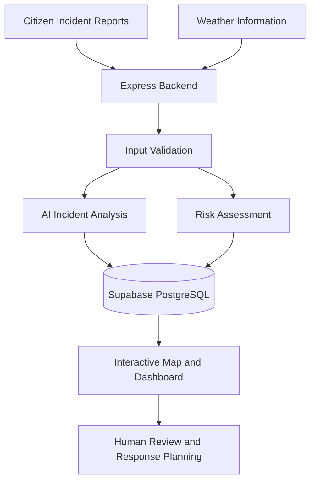

# FloodWatch
### AI-Powered Community Flood Intelligence and Response Support

FloodWatch is a community-driven flood intelligence platform designed to consolidate local hazard reports, weather information, and AI-assisted incident analysis into a unified operational view. It aims to help citizens, emergency responders, and local authorities better understand flood-related risks and make informed decisions during extreme weather events.

## 1. Problem Statement

During heavy rainfall and flooding, critical information is often fragmented across messaging platforms, social media, and emergency helplines. The lack of consolidated, location-specific incident intelligence makes it difficult to assess road conditions, identify emerging hazards, and prioritize response efforts.

FloodWatch addresses this challenge by bringing community reports and relevant contextual data together in a centralized platform.

## 2. Target Users and Context

FloodWatch is designed to support communities and organizations involved in local flood awareness and emergency response.

- **Citizens:** Submit reports of flooding, waterlogging, road blockages, and other hazards.
- **Emergency Responders:** Access structured incident information to support situational assessment and response planning.
- **Local Authorities:** Monitor reported incidents and review their severity and status.
- **Municipal Disaster Management Teams:** Use consolidated incident information to support local coordination and resource prioritization.

The platform focuses on flood-prone communities in Kerala, where seasonal monsoon rainfall can disrupt transportation, essential services, and daily activities.

## 3. Solution Overview

FloodWatch combines incident reporting, geospatial visualization, weather context, risk assessment, and AI-assisted analysis within a unified application.

### Core Capabilities

- **Incident Monitoring:** View reported hazards through an interactive map-based interface.
- **Community Reporting:** Capture incident descriptions, categories, and available location information.
- **AI-Assisted Incident Intelligence:** Generate structured incident classifications, severity assessments, summaries, and recommended actions.
- **Weather Context:** Incorporate available weather information to support local situational awareness.
- **Risk Assessment:** Use the implemented risk engine to evaluate available incident and environmental indicators.
- **Incident Management:** Store, retrieve, and review incident records through the backend and database.

### System Workflow



*The diagram represents the intended workflow; individual integrations and capabilities should be verified against the current implementation.*

## 4. Technology Stack

| Layer | Technology | Purpose |
|---|---|---|
| Frontend | React and Vite | User interface and interactive application |
| Backend | Node.js and Express | API endpoints, request validation, and business logic |
| Database | Supabase PostgreSQL | Persistent storage of incident records and AI analyses |
| AI Integration | OpenAI API, configured model | Structured incident analysis and recommendations |
| Weather Integration | Configured weather API | Weather context for incident assessment |
| Version Control | Git and GitHub | Source control and collaboration |

## 5. Installation and Setup

### Prerequisites

- Node.js and npm
- Git
- A configured Supabase project
- An OpenAI API key for AI-powered analysis
- Access to any additional external services required by the application

### Clone the Repository

```bash
git clone <YOUR_FLOODWATCH_REPOSITORY_URL>
cd FloodWatch
```

Replace the repository URL with the actual FloodWatch repository URL.

### Install Dependencies

Install dependencies in the frontend and backend directories using their respective `package.json` files.

```bash
cd backend
npm install
```

Then install frontend dependencies from the directory containing the frontend `package.json`.

### Configure Environment Variables

Create a backend `.env` file using the existing `.env.example` as a reference. Configure the variables required by the implementation.

```dotenv
PORT=5000
NODE_ENV=development
SUPABASE_URL=your_supabase_project_url
SUPABASE_SERVICE_ROLE_KEY=your_supabase_server_key
SUPABASE_ANON_KEY=your_supabase_anon_key
AUTHORITY_SECRET=your_random_authority_secret
OPENAI_API_KEY=your_openai_api_key
OPENAI_MODEL=gpt-4.1-mini
ALLOWED_ORIGINS=http://localhost:5173,http://127.0.0.1:5173
```

Replace the example values with your own configuration. Use only the variables required by your current codebase.

**Security requirements:**
- Never commit `.env` files or actual credentials to version control.
- Keep the OpenAI API key, Supabase server-side key, and authority secret exclusively on the backend.
- Use a strong, randomly generated authority secret.
- Configure production environment variables through the hosting provider's secure settings.

### Configure the Database

1. Open the Supabase project associated with the application.
2. Apply the required database schema and migrations.
3. Verify that the incident tables and required constraints exist.
4. Confirm that database access policies are appropriate for the application.

The AI analysis service uses the `incident_ai_analyses` table to persist structured analysis results associated with incident records.

### Run the Application

Start the backend using the development script defined in `backend/package.json`. Start the frontend from its own project directory using the script defined in the frontend `package.json`.

For example, where the configured scripts support these commands:

```bash
npm run dev
```

Use the actual scripts and ports defined in the repository. Verify the backend health endpoint and frontend API configuration before testing the application.

## 6. AI Models and Data

### AI Incident Analysis

FloodWatch integrates the OpenAI API to generate structured assessments from available incident information.

The analysis may include:
- Incident classification.
- Estimated severity and urgency.
- Potential road accessibility status.
- Evidence-based summaries and reasoning.
- Recommended next actions.
- Confidence estimates and human-review indicators.

The configured model is `gpt-4.1-mini`, subject to the application's environment configuration and available API access.

AI-generated classifications are estimates based on the supplied information. They do not independently verify real-world conditions.

### Data Sources

| Source | Purpose | Considerations |
|---|---|---|
| Citizen-submitted reports | Local observations of incidents and hazards | May be incomplete or unverified |
| Supabase PostgreSQL | Incident and analysis persistence | Requires appropriate access controls |
| Weather provider | Environmental and rainfall context | May not represent street-level conditions |
| OpenAI API | Structured analysis of incident information | Subject to model limitations, service availability, and usage costs |
| Mapping and geographic services | Visualize locations and geographic context | Provider terms and attribution requirements apply |

**Licensing and data provenance:** Verify the applicable licenses and terms of service for the selected weather provider, mapping libraries, map tiles, geographic datasets, and external APIs before deployment. Do not assume that all third-party data can be redistributed freely.

## 7. Evaluation and Safety Guardrails

FloodWatch is intended to support situational awareness rather than replace professional emergency assessment.

### Evaluation Approach

The system should be evaluated using:
- Classification accuracy against manually reviewed incident reports.
- False-positive and false-negative rates for severity classifications.
- API latency, failure rates, and availability.
- Agreement between AI assessments and human reviewers.
- Completeness, freshness, and geographic coverage of reported incidents.

Quantitative performance claims should be published only after testing against a documented evaluation dataset.

### Safety and Reliability

- Validate incoming requests and enforce authorization for sensitive operations.
- Validate structured AI responses before storing or displaying them.
- Treat incident descriptions as untrusted input and guard against prompt injection.
- Handle missing data, timeouts, and external service failures safely.
- Avoid presenting inferred information as verified fact.
- Flag uncertain or high-impact assessments for human review.
- Keep sensitive credentials out of client-side code and logs.
- Do not automatically change official verification status based solely on AI output.

FloodWatch does not guarantee route safety, replace official emergency instructions, or independently dispatch rescue teams.

## 8. Known Limitations and Risks

- Incident coverage depends on community participation and available reporting data.
- Submitted reports may be inaccurate, duplicated, or outdated.
- AI-generated assessments may contain errors or reflect incomplete information.
- Weather information may not accurately represent conditions on individual roads.
- Network outages can limit access to online services.
- External APIs may impose usage limits, availability restrictions, and costs.
- Predictive flood-risk estimates require suitable geographic and environmental data and independent validation.
- Operational effectiveness has to be established through field testing and collaboration with relevant stakeholders.

### Future Development Opportunities

Potential improvements include offline-first reporting, alternative reporting channels, sensor integration, improved geographic risk modelling, and responder coordination tools. These should be treated as future work until implemented and validated.

## 9. Team

| Name | Role | Profile |
|---|---|---|
| Karthik Sajan | Project contributor — confirm specific responsibilities | [GitHub / LinkedIn] |
| [Team Member] | [Role and responsibilities] | [Profile link] |
| [Team Member] | [Role and responsibilities] | [Profile link] |

Update this section with the actual project contributors and their preferred public contact information.

## 10. Project Status

FloodWatch is being developed as an AI-assisted community flood intelligence platform. Features, integrations, and operational readiness should be assessed against the current source code and documented test results.

Contributions, testing, and feedback are valuable for improving the platform's reliability, usability, and suitability for real-world disaster preparedness.
